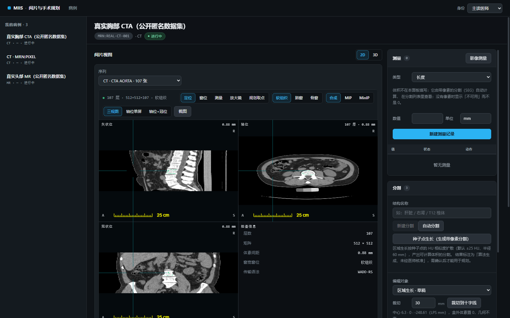
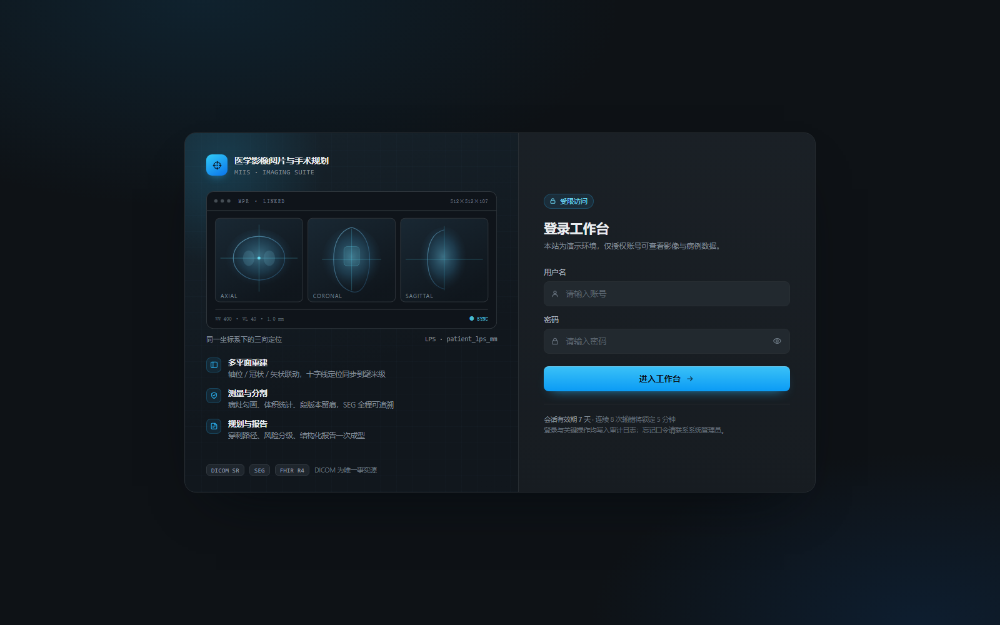
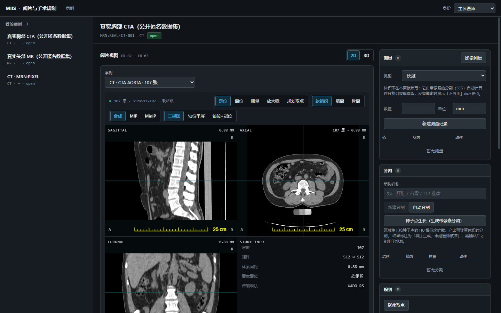
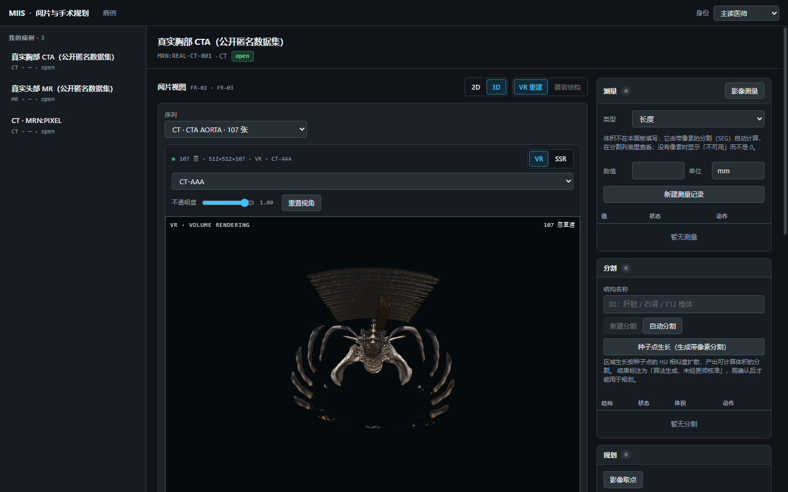
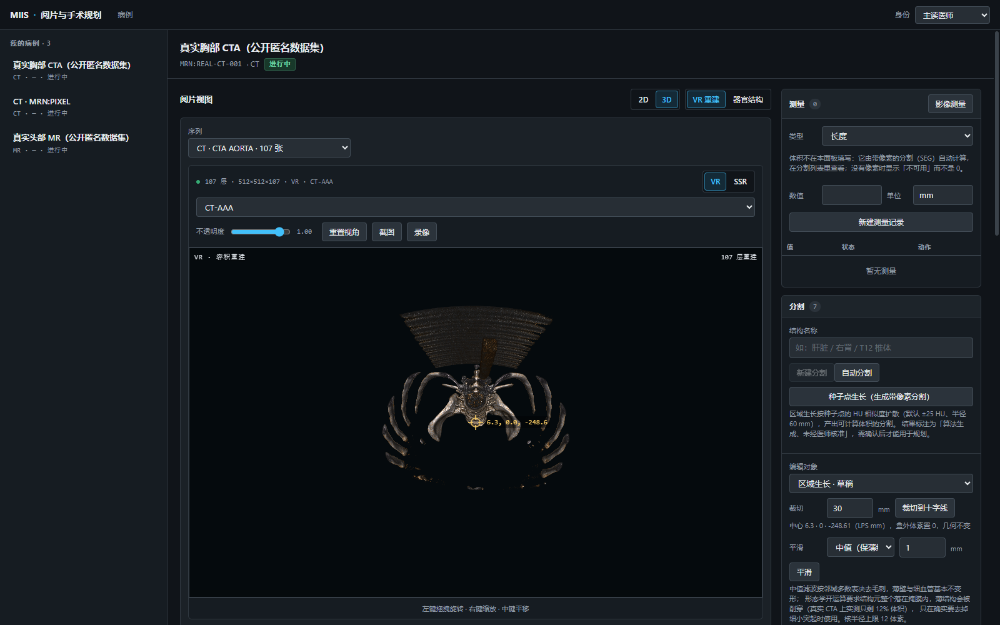
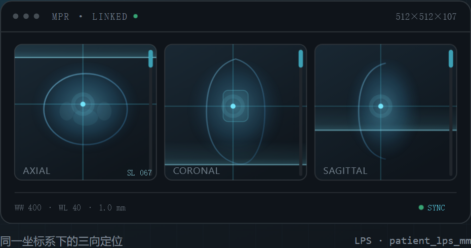
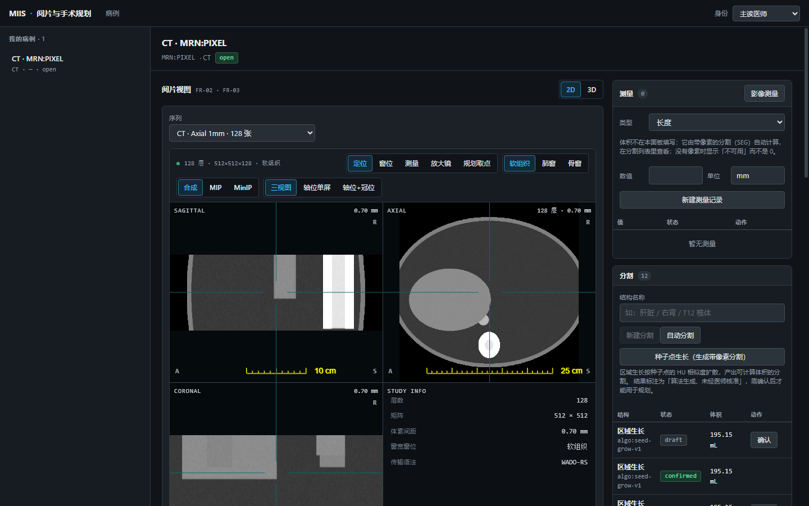
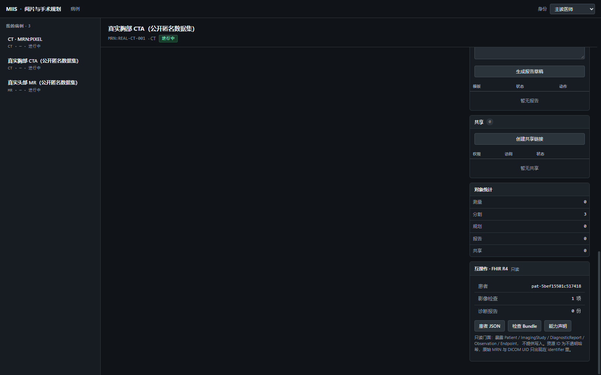

# 医学影像阅片与手术规划系统

Web 优先承载日常阅片，桌面端（3D Slicer）承载复杂规划，AI 推理以独立容器接入。所有核心对象（SR / SEG / Plan / Report）以合规 DICOM 持久化。

本仓库包含**需求文档**与**参考实现**两部分，实现严格遵循《接口与契约规范 v0.9》。





## 截图速览

真实胸部 CTA（公开匿名数据集）的三视图 MPR 与三维重建：





三维里的种子点生长与交互（十字线联动 / 截图 / 录像入口都在这一屏）：



二三维十字线联动的定位示意（同一坐标系下的三向定位）：



合成体模数据上跑区域生长后的分割列表（draft → confirmed 需医师确认）：



右侧「互操作」面板：FHIR R4 只读门面的资源预览：



---

## 一、交付文档

| 文档 | 版本 | 路径 |
|---|---|---|
| 可行性研究报告 | V1.0 | [medical-imaging-feasibility.html](medical-imaging-feasibility/medical-imaging-feasibility.html) |
| 产品需求文档 PRD | V0.9 | [medical-imaging-prd.html](medical-imaging-prd/medical-imaging-prd.html) |
| 接口与契约规范 | V0.9 | [medical-imaging-api-contract.html](medical-imaging-api-contract/medical-imaging-api-contract.html) |
| 开源选型结论 | — | [docs/OSS-SELECTION.md](docs/OSS-SELECTION.md) |

三份 HTML 均为自包含文档（无外网依赖），直接用浏览器打开即可评审；也可 `cd <目录> && python3 -m http.server 8888` 后访问。

---

## 二、项目结构

```
.
├── server/                    # FastAPI 服务端（契约参考实现）
│   ├── app/
│   │   ├── core/              # 配置、DB、错误体、幂等、审计、权限、ID
│   │   ├── models/            # 15 张表 + 5 张状态机转移表
│   │   ├── dicom/             # DICOM SR / SEG 生成（pydicom）
│   │   ├── adapters/          # DICOMweb、AI 推理服务适配器
│   │   ├── services/          # 业务服务层（状态机执行 + 校验 + 级联）
│   │   ├── api/v1/            # REST 端点（/api/v1 前缀）
│   │   └── main.py            # 应用入口
│   ├── tests/                 # 150 项测试（契约 / FHIR / 掩膜 / 像素）
│   └── Dockerfile
├── web/                       # Vite + React 阅片工作台
│   └── src/
│       ├── api/client.js      # 契约客户端（自动幂等键 + 业务码分支）
│       ├── pages/CaseWorkspace.jsx
│       └── styles.css
├── infra/
│   ├── docker-compose.yml     # Orthanc + PostgreSQL + AI（可选）
│   └── orthanc/orthanc.json
├── deploy/                    # 单端口部署形态的源码（入口/登录门/依赖清单）
├── scripts/                   # 打包部署、体模转换、演示库裁剪
├── docs/                      # 设计文档、决策记录（ADR）、截图
└── README.md
```

---

## 三、快速启动

### 3.0 一键启动（推荐）

```bash
# Windows：双击 启动.bat
node start.mjs            # 首次会自动建 venv、装依赖、构建前端并启动
node start.mjs --no-build # 已有 web/dist 时跳过构建，秒起
```

启动器会**自动避让被占用的端口**（默认后端从 8000、前端从 4173 起，被占则顺延），并把最终地址打印出来。

> ⚠️ 已知限制：Vite **dev 模式**下 `optimizeDeps` 预打包会破坏 dicom-image-loader 的 module worker，
> 导致 `loadImage()` 永久挂起（页面卡在「重建体数据」）。因此演示与验收请统一走**生产构建 + `serve-dist.mjs`**。

### 3.1 服务端

```bash
cd server
python3 -m venv .venv
.venv/bin/pip install -r requirements.txt
cp .env.example .env          # 可选，默认 SQLite 开箱即用

.venv/bin/uvicorn app.main:app --reload --port 8000
```

打开 http://localhost:8000/docs 查看 OpenAPI；契约自描述在 `GET /api/v1/contract`。

### 3.2 前端

```bash
cd web
npm install
npm run build                 # 产出 dist/
PORT=4173 MIIS_API=http://127.0.0.1:8001 node serve-dist.mjs
```

`serve-dist.mjs` 静态托管 `dist/`，并把 `/api`、`/dicomweb` 代理到 `MIIS_API` 指向的后端。

### 3.3 基础设施（可选，需 Docker）

```bash
# Orthanc（DICOM 事实源）+ PostgreSQL
docker compose -f infra/docker-compose.yml up -d orthanc postgres

# 启动后把 server/.env 指向它
# DICOMWEB_BASE_URL=http://localhost:8042/dicomweb

# AI 推理（需 NVIDIA Container Toolkit）
docker compose -f infra/docker-compose.yml --profile ai up -d
```

未配置 `DICOMWEB_BASE_URL` 时，服务端自动退化为内置文件存储（`server/.dicomstore/`），业务链路仍可完整跑通。

### 3.4 测试

```bash
cd server && .venv/bin/python -m pytest -q
# 150 passed（契约 / FHIR / 掩膜编辑 / 分割像素 / 体素体积 / 坐标系契约）
```

---

## 三点五、打包与部署

部署形态是一台 Linux 服务器 + systemd，要点：

- `node scripts/build-deploy.mjs` 组装部署包：后端代码 + 前端 dist + DICOM 归档 + 裁剪过的演示库
- 单端口 ASGI 入口：登录门（Cookie 会话 + 登录限速）→ 静态站点 → 复用全部业务路由；
  `/api` 未登录返回 401 JSON，页面请求 302 到登录页
- WADO/静态响应走 gzip（CT 像素约 2.3 倍压缩），公网弱网下整序列加载从 100s+ 降到 ~10s
- `scripts/trim_demo_db.py` 把 220MB 演示库裁到 31MB（保留 plan 引用的分割段 + 每例最近 3 个）
- 登录口令只从环境变量读（`MIIS_WEB_PASS`），未设置时启动随机生成一个并打印到控制台，
  见 [deploy/.env.example](deploy/.env.example)

systemd 单元示例：

```ini
[Service]
WorkingDirectory=/opt/miis
ExecStart=/opt/miis/.venv/bin/python deploy/main.py
Restart=always
```

> 安全提醒：默认是 HTTP 明文传输，登录口令与影像数据未加密。对外使用建议在 Caddy 上配域名 + TLS。

---

## 四、契约实现对照

| 契约条款 | 实现位置 |
|---|---|
| §0.1 单一事实源（DICOM） | [app/dicom/sr.py](server/app/dicom/sr.py)、[app/dicom/seg.py](server/app/dicom/seg.py) 生成合规实例；[app/adapters/dicomweb.py](server/app/adapters/dicomweb.py) 落库 |
| §0.2 幂等写操作 | [app/core/idem.py](server/app/core/idem.py) + [app/api/v1/deps.py](server/app/api/v1/deps.py) 的 `@idempotent` 装饰器 |
| §0.3 资源标识稳定 | [app/core/ids.py](server/app/core/ids.py)：UUID + `2.25.<int>` 形式的 DICOM UID |
| §0.4 状态转移封闭 | [app/models/state_machines.py](server/app/models/state_machines.py) 转移表 + [app/services/state.py](server/app/services/state.py) 执行器；端点一律 `:action` 形式 |
| §1.7 Share 访问码 | [app/models/share.py](server/app/models/share.py)：加盐 SHA-256，明文只返回一次 |
| §1.8 版本化引用 | [app/services/plans.py](server/app/services/plans.py) `resolve_base_segment` 强制校验 UID + version 一致 |
| §4 统一错误体 | [app/core/errors.py](server/app/core/errors.py) 业务码 ↔ HTTP 分层；[app/main.py](server/app/main.py) 全局异常处理器 |
| §5.4 幂等窗口 | 7 天 TTL，过期自动清理 |

### 角色权限矩阵

定义在 [app/core/security.py](server/app/core/security.py)，对应 PRD 各 FR 的 Permissions 表：

| 能力 | 主读 | 规划 | 审阅 | 规培 | 管理员 |
|---|:-:|:-:|:-:|:-:|:-:|
| 打开 / 查看 Case | ✓ | ✓ | ✓ | ✓ | ✓ |
| 触发自动分割 | ✓ | ✓ | — | ✓ | ✓ |
| 确认分割 | ✓ | ✓ | — | — | ✓ |
| 导出规划 | ✓ | ✓ | — | — | ✓ |
| 提交 / 锁定报告 | ✓ | ✓ | — | — | ✓ |
| 创建共享 | ✓ | ✓ | — | ✓ | ✓ |

AI 输出固定为 `suggested` 态（[app/services/segments.py](server/app/services/segments.py)），未经医师确认不能被 Plan / Report 引用——对应 PRD §6.2「AI 输出非自动生效」。

---

## 五、已知边界

以下是**有意未实现**的部分，不是缺陷：

1. **MPR 视口已真实渲染**：[web/src/components/MprViewport.jsx](web/src/components/MprViewport.jsx) 用 Cornerstone3D 4.22 做容积重建，输出轴位 / 矢状位 / 冠状位三视图，含十字线联动、三档窗宽窗位、合成 / MIP / MinIP 三种混合模式、放大镜、三种窗口布局（三视图 / 轴位单屏 / 轴位+冠位），以及影像内长度 / 角度 / 面积测量（mm / ° / mm²）。已实测：128 层 · 512×512 · 0.7mm 间距全量加载成功。
2. **三维 VR 体绘制已实现**：[web/src/components/VrViewport.jsx](web/src/components/VrViewport.jsx) 提供 `VOLUME_3D` 视口，含预设、不透明度调节、SSR 表面阴影模式与鼠标旋转；与 2D 之间用 CSS 隐藏切换（不卸载，避免体数据重复下载）。
   - **已含（2026-10-29）**：二三维十字线联动（MPR 十字线实时投影到 VR 准星与器官网格标记球）、二三维截图（canvas 合成 + 患者/序列/窗位信息条烧入 PNG）、模型旋转录像（脚本化环绕 360° 录制 webm）。
   - **未含**：多模态融合、同屏多序列并行、三维里反向拾取点回写十字线。多模态融合按 PRD FR-03 交由桌面端 3D Slicer 承载。
3. **DICOMweb 端点未代理**：`/dicomweb/*` 需由 Orthanc 直接承担（`infra/` 已编排），应用层不重复实现 WADO/QIDO/STOW，符合契约 §5.5「系统层不自定义 DICOMweb 字段」。
4. **HL7 v2 / FHIR**：**FHIR R4 只读门面已实现（2026-10-29）**——`GET /fhir/metadata` 与 Patient / ImagingStudy / DiagnosticReport / Observation / Endpoint 五类资源的 read + search（`app/fhir/`），错误在 `/fhir` 下返回 OperationOutcome、在 `/api/v1` 下保持契约错误体；可见性过滤与病例列表共用同一套规则，界面右侧「互操作」面板可直接预览资源 JSON。**仍待院内接口信息**：HL7 v2（需 Mirth/HAPI 集成引擎）、FHIR 写侧（ServiceRequest 接单 / Observation 回写）、订阅与 bulk export（PRD Q4 未决）。
5. **Plan 导出 PDF**：**有意不做**，见 [ADR-003](docs/decisions/ADR-003-report-pdf-out-of-scope.md)。DICOM SR 是唯一正式产物，打印由浏览器打印样式表承接。导航系统格式仍为 `[TBD]`（缺院内导航设备接口信息）。
6. **风险阈值与口径**：`SAFE_DISTANCE_LOW_MM=10` / `SAFE_DISTANCE_MEDIUM_MM=5` 为**待临床确认的暂定阈值**，见 [app/services/plans.py](server/app/services/plans.py) 的 `[Assumption, TBD]` 标记与 `docs/OPEN-DECISIONS.md` 的 Q-RISK-THRESHOLD。
   分级口径已改为**入路轴线到分割外表面的最小距离**（`anatomical_distance_mm`，Q-SAFE-DISTANCE 已关闭）：
   `safe_distance` 仍保留为入点到靶点的直线长度，两者分开存、分开显示，不再混用。
   无法分级的情况一律 `unknown` 并附 `risk_basis`：SEG 无像素 / 无空间定位 / **靶点本身位于分割内**（分割即靶区时，
   "到分割表面的距离"不构成风险判据，方向会反过来）。
7. **SEG 像素来源已打通（本地种子点区域生长）**：`POST /api/v1/cases/{id}/segments/grow`
   以种子点为中心做 HU 相似度区域生长，产出**带 PixelData 与完整空间定位**
   （PixelMeasures / PlaneOrientation / PlanePosition）的 BINARY SEG，
   体积计算与解剖距离因此真实可用。界面入口：分割面板「种子点生长」，
   在轴位视口点击靶点即可（UI 门禁 G13）。
   - 产出在 SEG 私有块标注 `clinical_use=NO` 与固定 notice：**算法生成、未经医师核准**，
     `SegmentAlgorithmType=SEMIAUTOMATIC`，需医师确认后才能被规划引用。
   - **全自动分割已接入（2026-10-28，ADR-002 修订）**：`server/.env` 里设
     `AI_LOCAL_INFER=1` 后，`POST /api/v1/ai/infer` 在本机跑 TotalSegmentator
     （nnU-Net，CPU `--fast`），多结构逐个回调产出 suggested 态带像素 SEG；
     `mode` 返回 `local` 如实标注。环境缺 CLI 时 422 拒绝，绝不静默退回桩。
     首跑会下载权重（数 GB），CPU 推理以分钟计。
   - MONAI Deploy（外部 AI 容器）仍是可选路径：配置 `AI_BASE_URL` 即优先走外部。
     医师手工勾画（TC-06）未接线，是后续的像素来源增强，不是缺口回退。
   - 见 `docs/OPEN-DECISIONS.md` Q-SEG-PIXELS（已关闭）与 `server/app/dicom/mask.py`。

8. **分割掩膜编辑（裁切 / 平滑 / 布尔）**：`POST /segments/{uid}:crop`（按 LPS 盒，
   支持 center+radius 或 min/max）与 `POST /segments/{uid}:smooth`（`method=median`
   默认中值滤波保薄结构；`method=morphology` 显式开/闭运算），布尔运算复用
   `POST /cases/{id}/segments/merge`。三者都**产出新的 draft 分割**（base_seg_uids
   指回源），源对象不动；几何一律不变、不重采样。空结果（裁切盒没罩住结构 /
   核把主体吃光）返回 422 而不是写一条 0 体素的记录。
   平滑默认中值的依据：真实 CTA 主动脉腔 4300 体素上，1mm 形态学开运算只保留
   12%（薄壁被削穿），中值保留 87% —— 保留率写进 seg_meta.stats.retention 可复核。
   实现：[app/services/mask_edit.py](server/app/services/mask_edit.py)，界面入口在
   分割面板「编辑对象」。

---

## 六、文档打开方式

```bash
# 方式一：直接双击 HTML（字体与图表走本地相对路径）
# 方式二：静态服务器（Mermaid 更稳定）
cd medical-imaging-api-contract && python3 -m http.server 8888
# http://localhost:8888/medical-imaging-api-contract.html
```